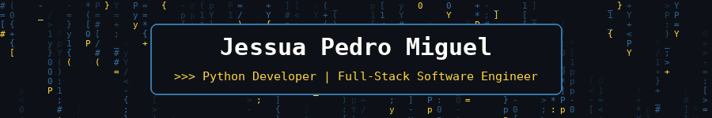
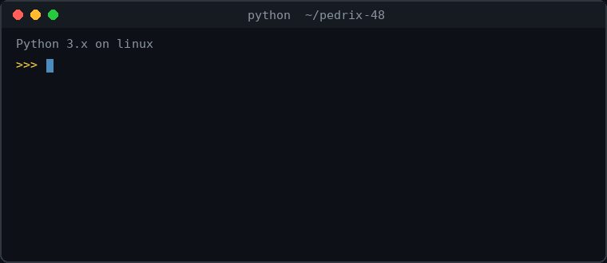

<div align="center">



<a href="https://github.com/pedrix-48">
  
</a>

<br/>


</div>


## `>>> about_me`

<div align="center">
  
</div>

<br/>

```python
from dataclasses import dataclass, field


@dataclass
class Developer:
    name: str = "Jessua Pedro Miguel"
    alias: str = "Pedrix"
    role: str = "Full-Stack Software Engineer"
    education: str = "Informatic Engineering, UNTL (FECT)"
    location: str = "Timor-Leste"
    languages: list = field(default_factory=lambda: [
        "Python", "C#", "Java", "JavaScript",
    ])
    focus: list = field(default_factory=lambda: [
        "Web Development", "Game Development", "Data Analysis",
    ])
    learning: list = field(default_factory=lambda: [
        "Advanced Django Architecture", "Data Science",
    ])
```


## `>>> tech_stack`

### Languages


### Backend and Frameworks


### Frontend


### Databases


### Data Analysis


### Game Development


### Tools and Systems


## `>>> projects`

```python
projects = [
    {
        "name": "SIG RUFECT",
        "description": "Dormitory management system for FECT-UNTL",
        "stack": ["Python", "Django", "Bootstrap", "MySQL"],
        "repo": "https://github.com/pedrix-48/rufect",
    },
    {
        "name": "Student Registration System",
        "description": "Registration system for the Student Association of FECT",
        "stack": ["Python", "Django"],
    },
]
```


## `>>> experience`

| Role | Technical work |
| --- | --- |
| **Web Developer & UI/UX Prototyper** | Builds and maintains websites for clients; turns ideas into Figma wireframes and high-fidelity designs |
| **Intern, FECT-UNTL (2025)** | Tested network equipment (switches and routers) and verified operational status and functionality |

**Recognition:** 2nd place, University-Level ICT Competition, TIC Timor 8th Anniversary (2025), representing UNTL


## `>>> github_stats`

<div align="center">


</div>


## `>>> contact`

<div align="center">

[](mailto:jessua.belper@gmail.com)
[](https://github.com/pedrix-48)

</div>